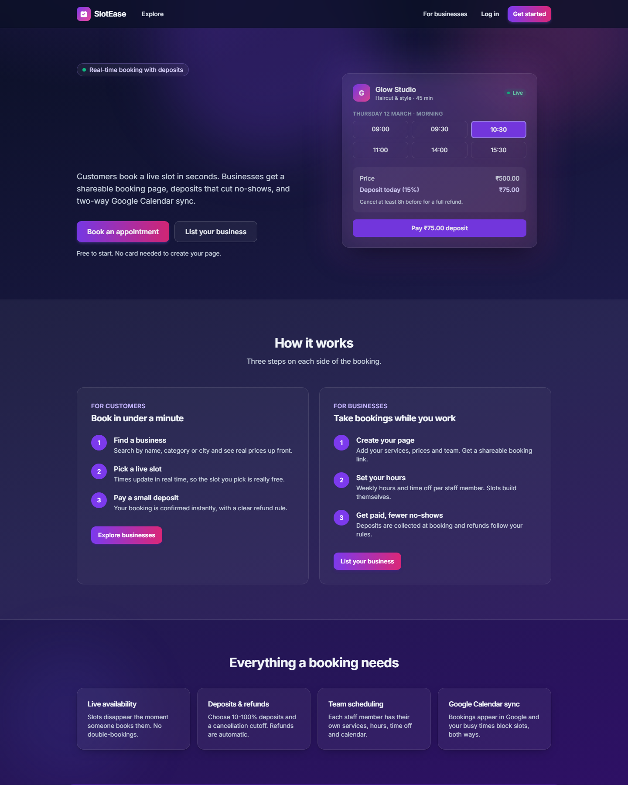
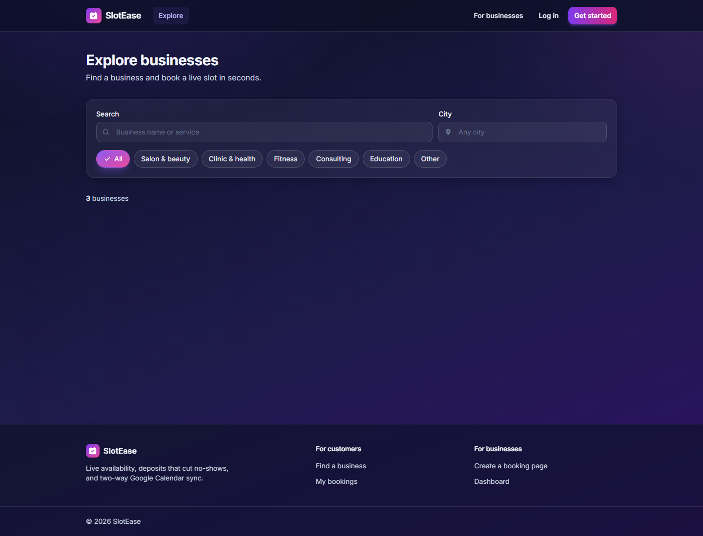
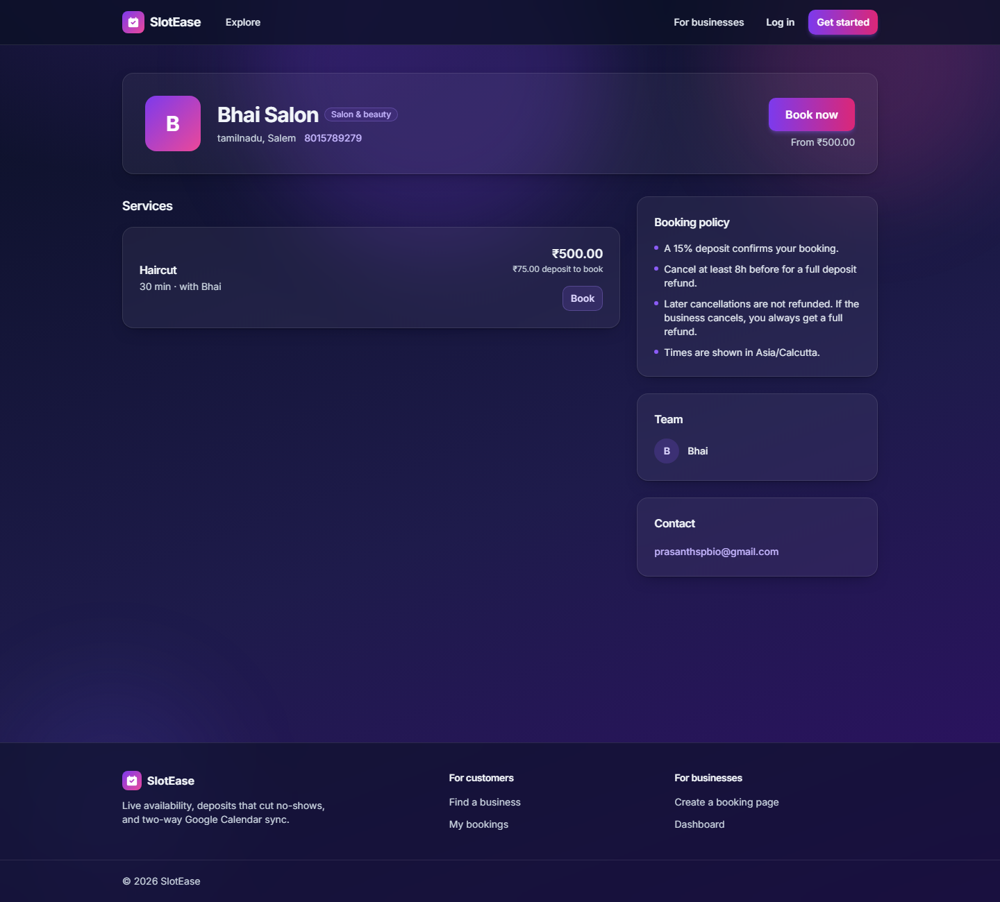
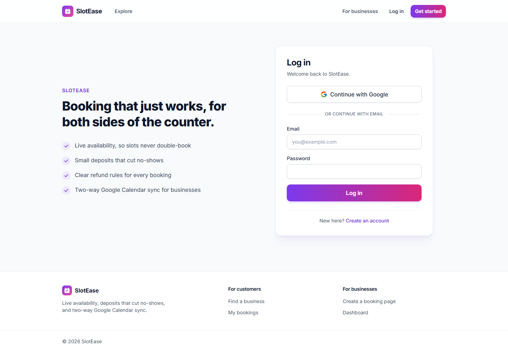
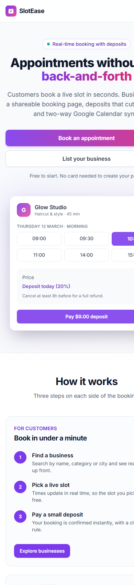

# SlotEase: Multi-Business Appointment Booking SaaS

🌐 **Live demo:** https://www.kowsalyagroups.com/techstack/appointment-booking/

Salons, clinics, tutors and consultants get their own public booking page. Customers see open slots in real time,
pay a deposit and book; owners and staff see new bookings live, and everything syncs both ways with Google Calendar.



## Features

- **Multi-tenant:** one platform, many businesses, each with services, staff and weekly availability
- **Real-time slots** over WebSockets, with database-level protection against double-booking
- **Deposits and refunds** through Dodo Payments (15% deposit, webhook-driven)
- **Two-way Google Calendar sync** for staff
- **Roles:** customer, business owner and staff; JWT and Google sign-in
- **Quality:** 221 automated tests, 85% backend coverage

## Tech stack

| Layer | Choice |
|---|---|
| Backend | FastAPI, Python 3.11, SQLAlchemy, Alembic |
| Frontend | React, TypeScript, Vite, Tailwind CSS, Framer Motion |
| Database | PostgreSQL |
| Real-time | WebSockets (FastAPI) |
| Payments | Dodo Payments |
| Calendar | Google Calendar API |
| Deploy | Docker Compose on a VPS, Nginx, HTTPS |

## Screenshots

| Explore | Business page |
|---|---|
|  |  |

| Login | Mobile |
|---|---|
|  |  |

## Run Locally

```bash
# Backend
cd backend
pip install -r requirements.txt
alembic upgrade head
uvicorn app.main:app --reload

# Frontend
cd frontend
npm install
npm run dev

# Docker
docker-compose up -d
```

---

## How it was built

The product brief is in [`INITIAL.md`](INITIAL.md). It was built with an agent-driven MicroSaaS workflow:
the brief becomes a blueprint in [`PRPs/`](PRPs), and specialised agents ([`agents/`](agents)) build the database,
backend, frontend, DevOps and tests in parallel, following the patterns in [`skills/`](skills).

## Author

**Prasanth Sundararajan** · [Portfolio](https://www.kowsalyagroups.com/prasanth/portfolio/) · [LinkedIn](https://www.linkedin.com/in/prasanth-s-a093a7109/) · [GitHub](https://github.com/prasanth-sundararajan)
